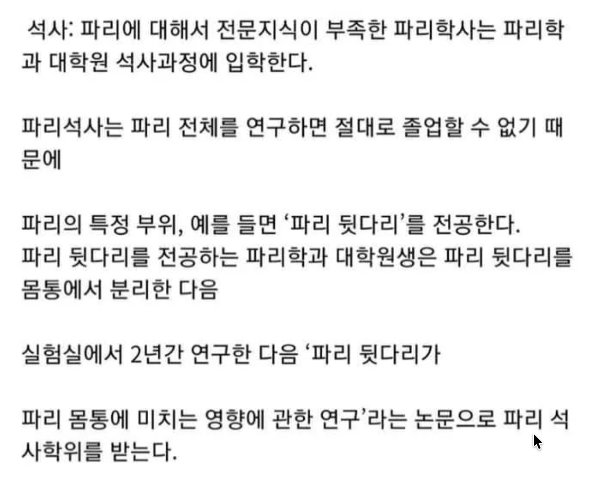

작년 7월즈음 인스타를 통해 인터뷰 요청을 받았습니다. 노션에만 묵혀놓기에는
아쉬워 약간의 수정을 거쳐 이곳에도 업로드합니다.

## 컴퓨터공학부라는 전공을 고르게 되신 이유가 무엇인가요?

초등학교 때 쓰던 스마트폰이 너무 느려 방법을 찾아보다 시스템을 수정하는 방법을
알게 되었고, 남이 만든 최적화 코드들을 적용해보았습니다. 제 글은 아니지만
[이런 느낌](https://blog.naver.com/simple3213/90124106310). 그 과정에서 그런
코드들을 짜는 개발자라는 직업이 멋지다 생각했고 자연스레 관심을 가졌습니다.

처음엔 코드 한 줄 치고 출력되는 걸 보는 것만으로도 재미있었습니다.
`print("Hello, World!")`를 입력하면 콘솔에 그대로 출력되는 것처럼, 컴퓨터에게
지시를 내려 무언가를 해냈다는 느낌이 신기했거든요.

그렇게 파고들다보니 **코드를 쌓아올려 복잡하고 거대한 무언가를 만들어낸다는
아이디어에 매료되었습니다**. 컴퓨터 공학에서 중요한 개념 중 하나가
'추상화(abstraction)'라고 합니다. 복잡한 내부 구조는 숨기고 상위에서는 단순한
인터페이스만 바라보면서 서로 다른 모듈들이 유기적으로 연결되는 방식이죠.

개발이라는 작업과 컴퓨터공학이라는 학문은 결코 혼자서 고립되어 하는 일이 아니라
본질적으로 협업적인 일입니다. 코드 하나는 절대 독립적으로 존재하지 않고 수많은
사람들의 작업과 연결되어 살아 움직이는 구조 속에 있다는 점이 매력적이었습니다.

물론 개발을 한다고 컴퓨터공학을 전공해야되는 법이 있는건 아니고 사실 독학으로도
충분하지 않을까 수십 번 고민했습니다. '개발은 실전이고, 컴공에서 배우는 이론은
실제로 쓸 일이 많지 않다'는 말도 종종 듣고, 실무 경험이 더 중요하지 않을까
싶기도 했고요. 하지만 직접 수업을 들어보고 판단해보자는 마음으로 복학 후 4학년
1학기에 '컴퓨터 구조' 수업을 들었는데 교수님께서 정말 열정적으로 가르쳐주셔서 더
공부해보고 싶었습니다. 그렇게 복수전공을 결심했고 후회하지 않습니다. 좋아하는
학문이라서 즐겁게 공부했습니다.

## 자교에서 대학원으로 진학을 꽤 하는 편인걸로 아는데, 대학원이 아닌 학사 취업을 하신 이유가 있나요?

대학원을 직접 경험해본 건 아니지만 좁고 깊게 탐구할 자신이 없었습니다.
학부에서는 '파리'를 배우고 대학원에선 '파리 앞다리의 다리털'을 배운다는 밈이
있는데, 그 정도로 하나의 주제를 몇 년씩 연구할 자신은 없었습니다. 물론 석사는
2~3년이면 졸업할 수 있지만, 그렇게까지 하고 싶은 뚜렷한 주제도 떠오르지
않았습니다.

반면 학사 취업을 하면 직접 만든 서비스가 누군가의 삶에 영향을 줄 수 있다는 점이
좋았습니다. 물론 대학원에서 연구를 통해 세상에 영향력을 끼칠 수도 있겠지만,
실무에서 서비스를 개발하는 것이 유저들과 더 가까운 곳에서 개발을 할 수 있겠다고
생각했습니다.

## 개발자로 취업을 하는 경우에는 학벌이 별로 중요하지 않고 실력이 중요하다는 말을 들었는데 사실인가요?

저는 인사담당자가 아니기에 각 기업들이 어떤 비중으로 사람을 뽑는지는 잘
모르지만, '개발자는 실력만 있으면 된다'류의 이야기를 정말 많이 들어왔기에
반대쪽에도 살짝 힘을 실어주겠습니다 ㅎ

"학벌 신경 쓰지 말고 실력만 키워라"라고 말하긴 조심스럽습니다. 좋은 대학에 가면
실력 좋은 사람들도 많고 인프라도 잘 갖춰져 있습니다. 학교를 단순히 지식을 배우는
공간으로만 보지 않고 사람을 만나는 곳으로 본다면 더 의미있는 공간이 됩니다.

돌아보면 학교에서 배운 지식보다도 학교에서 만난 사람들이 더 소중하게 느껴져요.
다양한 분야에서 살아가는 사람들을 만나고 시야를 넓히는 데에 큰 도움이
되었습니다. 저는 교내 개발 동아리에 소속되어 있는데, 좀 더 일찍 들어갈걸 하고
아쉬운 마음도 있습니다.

## 흔히 네카라쿠배라 하는 IT 직종에서의 대기업에 취업을 하려면 학부생 때 준비하면 좋을 것이 있는지

사실 제가 학부생 때 준비하면서 가장 중요하다고 느꼈던 건 **문제 해결
경험**입니다. 이게 자소서를 쓸 때 스토리텔링하기도 정말 좋고요. "누가 어떤
문제를 겪고 있었는지"를 정의하고, 그걸 해결하려고 고민해본 경험이 정말
소중하다고 생각합니다.

여기서 말하는 문제 상황은 단순히 사용자 불편 같은 사업적인 문제일 수도 있고,
**기술적인 문제**일 수도 있습니다. 예를 들면, 사람들이 많이 접속하면 끊긴다든지,
웹페이지 초기 로딩 속도가 너무 느리다든지, 특정 기획 변경에 유연하게 대응하기
어렵다든지, AWS 요금이 너무 많이 나온다든지요. 이런 문제를 해결하기 위해
검색해보거나, 직접 삽질하거나, 혹은 AI 도구들을 활용해가며 고민한 경험들을
기록해두면 정말 소중한 자산이 됩니다. 읽기 좋게 블로그에 올릴 필요까지도 없고,
메모장에 틈틈이 대충이라도 적어놓아보세요.

나중에 자기소개서나 면접 때도 훨씬 자연스럽고 설득력 있게 풀어낼 수 있어요.
'나만 겪었던 진짜 경험'이기 때문에 훨씬 살아 있는 이야기로 전달되거든요. 단순히
"이 기술을 써봤다"보다, "왜 썼고, 어떤 문제를 해결했고, 어떻게 접근했는지"가
드러나는 경험이 훨씬 강력하다고 생각해요.

## 어떤 개발 분야로 활동하고 계신가요?

프론트엔드 개발을 하고 있습니다. 웹 개발은 크게 프론트엔드와 백엔드로 나뉘는데,
프론트엔드는 사용자와 직접 맞닿는 UI를 만드는 영역이고, 백엔드는 데이터를
처리하고 서버 로직을 구현하는 영역이에요. 저는 사람들과 좀 더 가까운, 눈에
보이고 손으로 만지는 부분을 만드는 게 좋아서 자연스럽게 프론트엔드를 선택하게
됐습니다.

## 요즘 AI의 발전으로 많은 사람들이 개발자의 전망을 안 좋게 생각하고 있는데, AI가 개발자를 완전히 대체하긴 힘들다 생각합니다. 이에 대한 생각과 개발자의 미래 전망에 대한 개인적인 생각이 궁금합니다

프론트엔드 개발자로서
[The End of Frontend Development?](https://www.joshwcomeau.com/blog/the-end-of-frontend-development/)라는
글을 재미있게 읽었는데, 저도 저자의 의견에 동의합니다. 이 글에서는 AI가
프론트엔드를 완전히 대체하진 않겠지만, 지금과는 전혀 다른 모습이 될 것이라고
말합니다. 반복적인 작업은 자동화되고, 개발자의 역할은 점점 더 추상적이고
복합적인 문제 해결 중심으로 이동할 것이라는 내용입니다.

흔히 "개발자는 평생 공부하는 직업"이라고 하는데, 그 공부의 효율이 과거에 비해
비약적으로 높아졌다고 느낍니다. 마치 도서관에서 책 찾던 시대에서 구글이 처음
등장했을 때의 변화처럼요.

따라서 개발자에게 요구되는 능력의 범위는 점점 넓어질 것입니다. AI 도구에 질문만
잘해도 기본적인 기능은 금방 구현해볼 수 있습니다. 그 덕분에 학습 장벽이 낮아졌고
학습 속도도 빨라졌습니다.

앞으로는 프론트엔드와 백엔드의 구분도 점점 흐려지고, 풀스택 역량이 기본값처럼
요구되지 않을까 생각합니다. 저 역시 백엔드를 전혀 몰랐는데 최근에는 Cursor와
GPT를 활용해 데이터베이스를 설계하고 댓글 기능을 구현해보기도 했어요. 예전
같았으면 엄두도 못 냈을 일인데, 이제는 일단 해볼 수 있는 환경이 되었습니다.

결국 중요한 것은 AI를 잘 쓰는 사람과 그렇지 못한 사람 사이의 차이라고
생각합니다. 개발자는 사라지는 직업이 아니라, 역할과 정의가 새롭게 바뀌는 직업이
될 것이라고 생각해요.

요즘에는 AI에 대한 hype이 너무 커서 AI를 '도구'가 아니라 '목적 그 자체'로 보는
분위기가 있는 것 같습니다. 마치 공부할 때 형광펜 브랜드만 열심히 고르는
것처럼요. 물론 AI 자체가 목적인 회사도 있겠지만 대부분의 경우에는 "그래서 AI로
무엇을 만들 것인가?"에 대한 고민이 함께 따라야 한다고 생각합니다. 기술은 수단일
뿐, 결국 무엇을 만들고 어떤 문제를 해결하느냐가 더 본질이라고 생각합니다.
