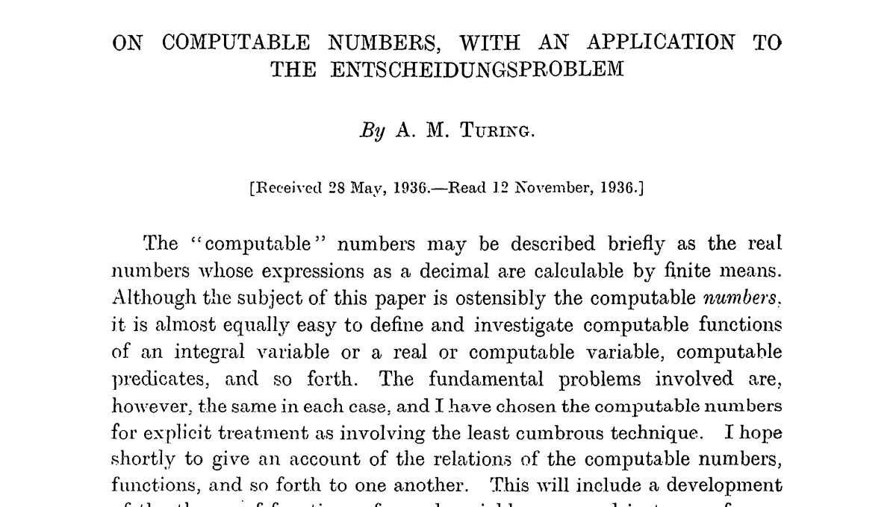

import TuringMachine from "./components/TuringMachine";

덧셈 회로는 덧셈을 하고, 주판은 셈을 합니다. 그런데 '계산한다'는 것은 정확히
무엇일까요? 이 질문에 답하려면 한 수학자의 아이디어부터 살펴봐야 합니다.

## 계산의 본질을 찾아서

영국의 앨런 튜링이 1936년에 발표한 '계산 가능한 수'라는
[논문](https://www.cs.virginia.edu/~robins/Turing_Paper_1936.pdf)에서 제안한
**튜링 머신**이 바로 그 출발점입니다.

튜링이 이 개념을 제안한 배경에는 당시 수학계의 중요한 문제가 있었습니다. 다비트
힐베르트가 제기한 무시무시한 이름의 '결정 문제(Entscheidungsproblem)'는

> 주어진 수학 명제가 참인지 거짓인지를 기계적으로 판단할 수 있는가?

라는 질문이었습니다. 튜링은 이 질문에 **아니오**라고 답했습니다. 어떤 기계적
절차로도 판단할 수 없는 문제가 존재한다는 것을 증명한 것입니다. 튜링은 이 문제를
해결하기 위해 먼저 '계산이란 무엇인가'를 정의해야 했습니다. 그가 택한 방법은
계산을 수행하는 가상의 기계를 설계하고, **이 기계가 수행할 수 있는 것이 곧
계산이다**라고 정의하는 것이었습니다. 이 기계가 바로 **튜링 머신**입니다.

## 튜링 머신의 구조

튜링 머신은 세 가지로 구성됩니다:

- **테이프**: 기호가 적힌 긴 띠
- **헤드**: 테이프 위의 기호를 읽고 쓰며, 좌우로 한 칸씩 이동
- **제어 장치**: 현재 상태와 규칙에 따라 헤드의 동작을 결정

아래는 테이프의 각 비트를 반전시키는 튜링 머신입니다. 재생 버튼을 눌러 동작을
확인해봅시다.

<TuringMachine
  initialTape={Array.from("01010_")}
  initialHeadIdx={0}
  rulesCsv={`
q0,0,q0,1,R
q0,1,q0,0,R
q0,_,q_halt,_,_
`}
  client:idle
/>

규칙 세 줄만으로 비트 반전이 가능합니다. 그렇다면 더 복잡한 계산은 어떨까요?
아래는 이진수 덧셈을 수행하는 튜링 머신입니다. 1112 + 102
= 10012가 계산되는 과정을 확인해봅시다. 규칙이 복잡해 보이지만
걱정하지 않아도 됩니다. 여기서 중요한 것은 각 규칙의 내용이 아니라, 읽고 쓰고
이동하는 단순한 동작의 반복만으로도 덧셈이 가능하다는 사실입니다.
([규칙 출처](https://stackoverflow.com/a/63309182/30126918))

<TuringMachine
  initialTape={Array.from("_111_10_")}
  initialHeadIdx={1}
  rulesCsv={`
q0,0,q0,0,R
q0,1,q0,1,R
q0,_,q1,_,R

q1,0,q1,0,R q1,1,q1,1,R q1,_,q2,_,L

q2,0,q2,1,L q2,1,q3,0,L q2,_,q5,_,R

q3,0,q3,0,L q3,1,q3,1,L q3,_,q4,_,L

q4,0,q0,1,R q4,1,q4,0,L q4,\_,q0,1,R

q5,0,q5,_,R q5,1,q5,_,R q5,_,q_halt,_,N `} client:idle />

읽기, 쓰기, 이동. 이 단순한 동작의 반복만으로 덧셈까지 가능합니다. 튜링의 통찰은
바로 이것이었습니다: **이 단순한 기계로 계산 가능한 모든 것을 표현할 수
있습니다.** 하지만 이대로면 여느 도구들과 다를 바가 없습니다. 비트를
반전시키거나 덧셈을 하는 특수한 도구일 뿐입니다. 기계는 그대로 두고 규칙만 바꿔
끼우는 방법은 [보편 튜링 머신](/universal-turing-machine)에서 다룹니다.
