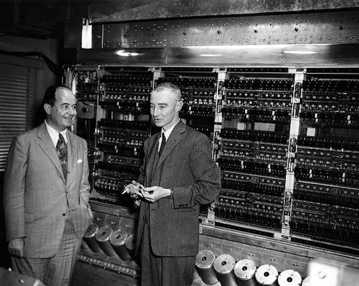

import TuringMachine from "../10-turing-machine/components/TuringMachine";

숫자를 0과 1로 표현하면 덧셈과 뺄셈을 하는 회로를 만들 수 있습니다. 사진을 0과
1로 표현한다면, 그 사진을 편집할 수 있는 회로도 만들어볼 수 있을 것입니다.

하지만 우리가 매일 쓰는 컴퓨터는 앱을 설치하고, 브라우저로 뉴스를 읽다가 영상을
보기도 합니다. 이런 다재다능함은 덧셈 회로나 메모리 회로에서는 찾아볼 수
없습니다. 이런 회로들만으로는 우리가 익숙하게 사용하는 '컴퓨터'라고 부르기엔
어딘가 부족함이 느껴집니다. **컴퓨터와 다른 도구들 사이에는 근본적인 차이가
있습니다.** 가위는 '자르는 것', 컵은 '담는 것'처럼 하나의 명확한 역할로 정의할
수 있지만, 컴퓨터는 이런 식으로 단순하게 정의할 수 없습니다. 컴퓨터에는 다른
도구들과는 다른, 더 본질적인 특성이 있는 것 같습니다.

그렇다면 무엇을 만들어야 컴퓨터를 만들었다고 할 수 있을까요? 이 시리즈의 목표는
컴퓨터를 직접 만들어보는 것이었지만 사실 우리는 컴퓨터가 무엇인지도 명확히
정의하지 않았습니다. **이번 글에서는 컴퓨터가 무엇인지 정의해 봅시다.**

## 보편 튜링 머신

읽기, 쓰기, 이동만으로 계산하는 [튜링 머신](/turing-machine)은 규칙에 따라 비트
반전이나 덧셈 같은 고정된 작업만 수행할 수 있습니다. 새로운 작업을 하려면 새로운
기계를 만들어야 합니다.

하지만 튜링은 한 가지 더 나아갑니다. 테이프에 **프로그램**(다른 튜링 머신의
규칙들)을 적어 넣으면, 그 프로그램에 해당하는 튜링 머신처럼 동작하는 기계를 만들
수 있습니다. 이것이 **보편 튜링 머신(Universal Turing Machine)**입니다. 덧셈
규칙을 넣으면 덧셈기가 되고, 곱셈 규칙을 넣으면 곱셈기가 됩니다.

아래 시뮬레이터에서 제어 장치의 규칙을 직접 수정할 수 있습니다. 비트를
반전시키는 프로그램을 전부 0으로 만들거나 1로 만드는 프로그램으로 바꿔봅시다.
규칙의 쓰기 값(세 번째 열)만 바꾸면 됩니다.

<TuringMachine
  initialTape={Array.from("11010_")}
  initialHeadIdx={0}
  rulesCsv={`
q0,0,q0,1,R
q0,1,q0,0,R
q0,_,q_halt,_,_
`}
  editable
  client:idle
/>

핵심은 **기계는 그대로 두고 규칙만 바꾸면 된다**는 것입니다. 기계가 수행할
논리를 데이터처럼 다룰 수 있다는 이 발상이 하드웨어와 소프트웨어의 분리, 그리고
오늘날 프로그래밍의 출발점이 되었습니다.

## 컴퓨터의 정의

위키피디아에서는 컴퓨터를 이렇게 정의합니다:

> 컴퓨터는 산술 또는 논리 연산의 일련의 과정을 자동으로 수행하도록
> **프로그래밍할 수 있는** 기계이다.

서론에서 가위는 '자르는 것', 컵은 '담는 것'으로 정의할 수 있지만 컴퓨터는 그렇게
정의할 수 없다고 했습니다. 이제 그 이유가 분명해집니다. 컴퓨터의 본질은 특정
기능이 아니라 **프로그램에 따라 어떤 계산이든 수행할 수 있다**는 점에 있습니다.
지금까지 만든 회로들에 부족했던 것이 바로 이 프로그램 가능성입니다.

## 마무리

위에서 직접 조작한 시뮬레이터도 보편 튜링 머신의 구현체입니다. 하지만 테이프와
헤드라는 모델은 이론적으로는 완벽해도, 실제 전자 회로로 만들기에는 적합하지
않습니다. [다음 글](/stored-program)에서는 튜링의 아이디어를 논리 게이트와
회로로 실현할 수 있도록 설계된 **폰 노이만 구조**를 살펴봅시다.
