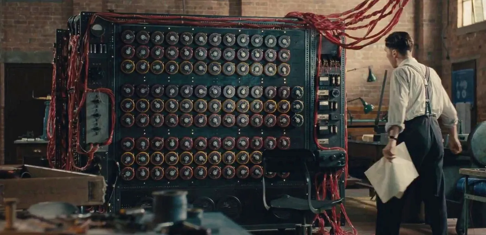

컴퓨터는 [프로그래밍 가능한 기계](/universal-turing-machine)입니다. 튜링이
계산하는 기계에 대한 이론적 토대를 마련했지만 여전히 중요한 질문이
남아있었습니다. 어떻게 그 기계를 현실 세계에 구현할 수 있을까요?

## "전선 수천 개를 갈아끼우라고요?"

폰 노이만 구조 이전의 초기 컴퓨터들은 비효율적이었습니다:

> ENIAC을 이후의 모든 컴퓨터들과 구분짓는 특이한 점 중 하나는, 명령어를 기계에
> 설정하는 방식이었다. 그것은 소형 천공 카드 기계의 플러그보드와 유사했지만,
> ENIAC에서는 수 피트 크기의 플러그보드가 약 40개나 있었고, 문제 하나의
> 명령어마다 다수의 와이어를 꽂아야 했다. 문제 하나를 실행 준비하기 위해서는
> 수천 개의 와이어를 연결해야 했으며, 이 작업에는 수일이 걸렸고, 그 설정을
> 검증하는 데에는 더 많은 날들이 필요했다.
>
> Franz L. Alt, "Archaeology of Computers—Reminiscences, 1945–1947,"
> Communications of the ACM, Vol. 15, No. 7, July 1972, p. 694.

결국 ENIAC에게 **프로그램이란 기계의 물리적인 구조 그 자체였습니다**. 새로운
요리를 할 때마다 부엌 구조를 통째로 바꾸는 셈입니다.

## 내장형 프로그램 방식

1945년 존 폰 노이만은 **프로그램을 하드웨어의 배선이 아닌 데이터로
취급**함으로써 이 문제를 해결했습니다. 부엌은 그대로 두고 요리법만 바꾸는
것입니다. 이것이 **내장형 프로그램 방식(Stored-Program Computer)**입니다.
메모리에 저장된 프로그램만 새로 불러오면 컴퓨터가 완전히 다른 작업을 수행합니다.

그런데 **"프로그램이 데이터"라는 게 구체적으로 무슨 뜻일까요?** 이를 이해하기
위해서는 컴퓨터가 이해할 수 있는 언어인 기계어가 어떻게 생겼는지 살펴봐야
합니다.

## 기계어

[0과 1](/zero-and-one)에서 살펴봤듯이 컴퓨터는 정보를 0과 1로만 표현하며,
프로그램도 예외는 아닙니다. 컴퓨터가 이해할 수 있는 언어, 즉 **기계어**는 모두
0과 1의 조합으로 이루어져 있습니다. 예를 들어 "두 숫자를 더해라"라는 명령을
컴퓨터에게 내리고 싶다면, 우리는 `00110000`과 같은 이진 숫자로 번역해서 전달해야
합니다.

**하지만 여기서 중요한 것은 `00110000`이 덧셈을 의미한다는 것 자체에는 어떤
마법도 없다는 점입니다.** 이는 단순히 CPU를 설계하는 사람과 프로그램을 짜는 사람
사이의 약속일 뿐입니다. "`0011`으로 시작하는 명령어를 보면 덧셈 회로를
작동시키자"고 미리 정해둔 규칙인 것입니다.

예를 들어 `01100011`이라는 8비트 숫자는 이렇게 해석될 수 있습니다:

- 앞 4비트 `0110` → "값을 넣어라" (LDI 명령)
- 다음 2비트 `00` → "R0에" (대상 지정)
- 마지막 2비트 `11` → "숫자 3을" (값 지정)

즉 **"R0에 3을 저장해라"**라는 뜻입니다. `0110`이 "값을 넣어라"를 의미한다는
것에 어떤 마법도 없습니다. CPU 설계자와 프로그래머 사이의 약속일 뿐입니다. 이런
약속들을 모아놓은 것을 **명령어 집합 구조(Instruction Set Architecture,
ISA)**라고 부릅니다. 이 시리즈에서는 핵심 원리를 이해하기 위해 간단한 8비트
ISA를 직접 설계했습니다. 전체 명령어는 [명령어 집합](/instruction-set)에서
살펴봅니다.

## 마무리

프로그램을 데이터로 메모리에 저장하는 **내장형 프로그램 방식** 덕분에 전선을
갈아끼울 필요 없이 메모리 내용만 바꾸면 컴퓨터가 전혀 다른 작업을 수행합니다.
[다음 글](/von-neumann)에서는 이 방식을 따르는 컴퓨터가 어떤 부품으로
이루어지는지 살펴봅시다.
