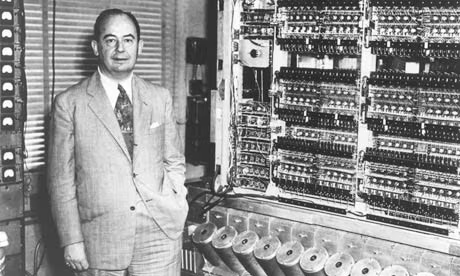

import { MonitorSimulator } from "./components/MonitorSimulator";
import { VonNeumannDiagram } from "./components/VonNeumannDiagram";
import { Table } from "@yeolyi/ui/Table";

수학자이자 물리학자이자 컴퓨터 과학자이자 경제학자였던 존 폰 노이만이 1945년에
제시한 **폰 노이만 구조**는 오늘날 우리의 스마트폰부터 슈퍼컴퓨터까지 거의 모든
컴퓨터가 따르고 있는 기본 설계 원리입니다. 핵심은 프로그램을 배선이 아닌
[데이터로 메모리에 담는다](/stored-program)는 것입니다.

## 폰 노이만 구조

폰 노이만 구조 컴퓨터는 크게 **메모리**, **CPU**, **입출력 장치**로 구성됩니다.

<VonNeumannDiagram />

이 중 비교적 직관적인 메모리와 입출력 장치부터 살펴봅시다.

## 메모리

메모리는 프로그램과 데이터를 저장하는 장치입니다. 이 메모리를 **RAM(Random
Access Memory)**이라 부르는데, 어떤 주소든 동일한 시간에 접근할 수 있기
때문입니다.

<Table>
  <thead>
    <tr>
      <th>주소</th>
      <th>데이터</th>
    </tr>
  </thead>
  <tbody>
    <tr>
      <td>0</td>
      <td className="font-mono">01100011</td>
    </tr>
    <tr>
      <td>1</td>
      <td className="font-mono">00010001</td>
    </tr>
    <tr>
      <td>2</td>
      <td className="font-mono">10010101</td>
    </tr>
    <tr>
      <td>3</td>
      <td className="font-mono">00000000</td>
    </tr>
  </tbody>
</Table>

예를 들어 '0번 주소에서 데이터를 가져와라'라고 하면 `01100011`이 나옵니다. '3번
주소에 50을 저장해라'라고 하면 해당 위치의 값이 바뀝니다.

여기서 핵심은 **프로그램과 데이터가 같은 메모리에 저장된다**는 점입니다. ENIAC은
프로그램이 물리적인 배선이었기 때문에 데이터와 완전히 별개였습니다. 폰 노이만
구조 에서는 기계어 명령어도 `00110000` 같은 숫자일 뿐이므로 데이터와 동일한
방식으로 메모리에 저장됩니다. 덕분에 프로그램을 바꾸고 싶으면 전선을 만질 필요
없이 메모리 내용만 바꾸면 됩니다.

## 입출력 장치

CPU가 외부 세계와 소통하는 창구입니다. 키보드, 마우스, 모니터 등이 여기에
해당합니다.

**입출력 장치를 구현하는 한 가지 방법은 메모리를 활용하는 것입니다**. 특정
메모리 주소 영역을 입출력 장치 전용으로 지정해두고, CPU는 해당 주소에 값을
읽거나 쓰는 방식으로 장치를 제어합니다.

예를 들어 모니터 화면의 각 픽셀을 메모리 주소에 일대일로 매칭해둘 수 있습니다.
이 메모리 영역을 비디오 메모리(VRAM)라고 합니다.

<MonitorSimulator client:load />

VRAM 값 1은 검은색, 0은 흰색 픽셀에 대응합니다. 값을 바꿔 화면 변화를
확인해봅시다. 키보드도 비슷하게, 특정 주소에 마지막으로 눌린 키 코드가 기록되면
CPU는 해당 주소를 읽어 입력을 받아올 수 있습니다.

## 마무리

프로그램을 데이터로 메모리에 저장하는 폰 노이만 구조에서 **메모리**와 **입출력
장치**의 역할을 살펴보았습니다. 모니터든 키보드든 CPU 입장에서는 정해진 메모리
주소의 값을 읽고 쓰는 일일 뿐입니다.

그러면 명령어를 실행하는 건 누구일까요? [다음 글](/data-transfer)에서 CPU가
이해하는 명령어를 하나씩 알아봅시다.
