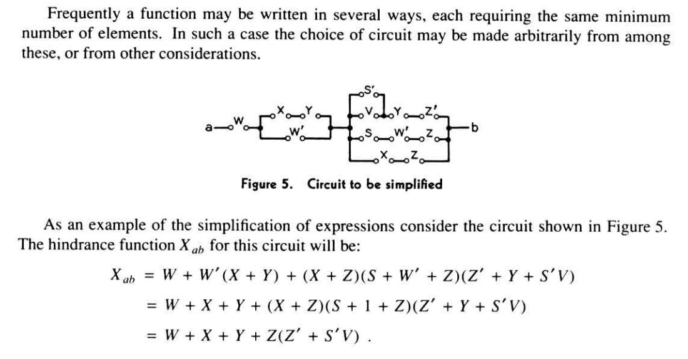

import TruthTable from "@mdx/components/TruthTable";

지난 글에서는 왜 컴퓨터가 세상을 0과 1이라는 단순한 비트로 표현하는지
살펴보았습니다. 하지만 비트들을 그저 저장만 하고 있다면 그건 단순한 기억 장치에
불과할 것입니다. 컴퓨터의 진짜 능력은 이 비트들을 가져다 의미 있는 방식으로
처리하여 우리가 원하는 결과를 만들어내는 데 있습니다.

그렇다면 이 0과 1에 어떻게 의미를 부여하고 논리적인 판단의 기초로 삼을 수
있었을까요?

## 불 대수

그 기반은 19세기 영국 수학자 조지 불(George Boole)이 제시한 **불 대수(Boolean
Algebra)**에서 찾을 수 있습니다. 불은 인간의 논리적 사고 과정을 참과 거짓이라는
단 두 가지 값과 몇 가지 기본 연산만으로 수학처럼 명쾌하게 표현할 수 있는 체계를
만들었습니다. 불 대수에는 여러 연산이 있는데, 그중 대표적인 몇 가지를
살펴봅시다.

- **논리곱(AND, ∧)**: A와 B가 **모두** 참일 때만 참
- **논리합(OR, ∨)**: A 또는 B **중 하나라도** 참이면 참
- **부정(NOT, ¬)**: 참과 거짓을 뒤집음

예를 들어 자동차가 교차로에서 직진할지 판단하는 상황을 생각해봅시다. "신호등이
초록불**이고**(∧) 전방에 장애물이 **없으면**(¬)" 직진합니다. 이 판단은 불 대수로
다음과 같이 표현됩니다.

> 직진 = 초록불 ∧ ¬장애물

이처럼 논리적 판단을 불 연산자의 조합으로 나타낼 수 있다는 것이 불 대수의
핵심입니다.

## 0과 1로 표현하기

컴퓨터가 정보를 표현하기 위해 사용하는 0과 1이라는 두 가지 상태는 불 논리의 참과
거짓을 나타내는 데 완벽한 수단이었습니다. 사람들은 컴퓨터의 **0을 거짓으로, 1을
참으로** 약속함으로써 기계 내부의 단순한 전기 신호에 논리적인 의미를 부여할 수
있었습니다.

이 약속 덕분에 하나 이상의 참/거짓 값을 입력받아 정해진 규칙에 따라 참/거짓을
내놓는 함수인 **불 함수(Boolean Function)**를 0과 1로 다룰 수 있게 됩니다. 불
함수의 규칙을 모든 입력 조합에 대해 빠짐없이 정리한 표가 바로 **진리표(Truth
Table)**입니다. 앞서 본 자동차의 직진 판단을 진리표로 펼치면 다음과 같습니다.

<TruthTable
  labels={[
    { label: "초록불", type: "input" },
    { label: "장애물", type: "input" },
    { label: "직진", type: "output" },
  ]}
  data={[
    [false, false, false],
    [false, true, false],
    [true, false, true],
    [true, true, false],
  ]}
  client:idle
/>

두 비트를 더하는 덧셈조차 불 함수로 표현됩니다.

<TruthTable
  labels={[
    { label: "A", type: "input" },
    { label: "B", type: "input" },
    { label: "합", type: "output" },
    { label: "올림", type: "output" },
  ]}
  data={[
    [false, false, false, false],
    [false, true, true, false],
    [true, false, true, false],
    [true, true, false, true],
  ]}
  client:idle
/>

1 + 1을 하면 합은 0이 되고 올림이 1이 생겨서 이진수로 10, 즉 십진수 2가 됩니다.
이처럼 산술 연산마저 참과 거짓의 논리적 조합으로 환원됩니다. **컴퓨터 내부에서는
이렇게 진리표로 정의되는 수많은 불 함수들이 모든 판단과 연산을 수행하고
있습니다.**

## 논리에서 회로로

하지만 0과 1로 표현된 참/거짓 값들을 실제로 가져다가 새로운 참/거짓 결과를
만들어내는 물리적인 방법, 즉 '연산 회로'를 어떻게 만들 수 있을까요? 추상적인
논리와 실제 전기 회로를 구체적으로 연결하여 연산을 가능하게 하는 방법을 제시한
사람이 바로 미국의 과학자이자 수학자인 클로드 섀넌입니다.

섀넌은 1937년, 그가 스물한 살이던 해에 MIT에서 발표한 그의 석사 학위 논문 A
Symbolic Analysis of Relay and Switching Circuits에서 핵심적인 통찰을
보여주었습니다.

그는 0(거짓)과 1(참)로 표현되는 **불 대수의 원리들이 스위치(켜짐/꺼짐)로
작동하는 전기 회로를 설계하고 분석하는 데 그대로 적용될 수 있음**을 수학적으로
증명해 보였습니다. 덕분에 복잡하기만 했던 전기 회로 설계가 명확한 수학적 원리를
따르는 과학의 영역으로 들어올 수 있게 되었습니다. 그의 석사 논문은 디지털 시대의
문을 연 핵심적인 연구로 인정받고 있습니다.

## 마무리

이렇게 해서 0과 1이라는 단순한 비트에 **불 대수**를 통해 논리적인 의미를
부여하고, **진리표**로 불 함수의 동작을 정의하며, **섀넌**의 통찰로 이 추상적인
논리가 실제 전기 회로로 구현될 수 있음을 확인했습니다.

다음 글에서는 이 논리를 실제로 구현하는 기본 부품인 AND, OR, NOT 논리 게이트를
살펴봅시다.
