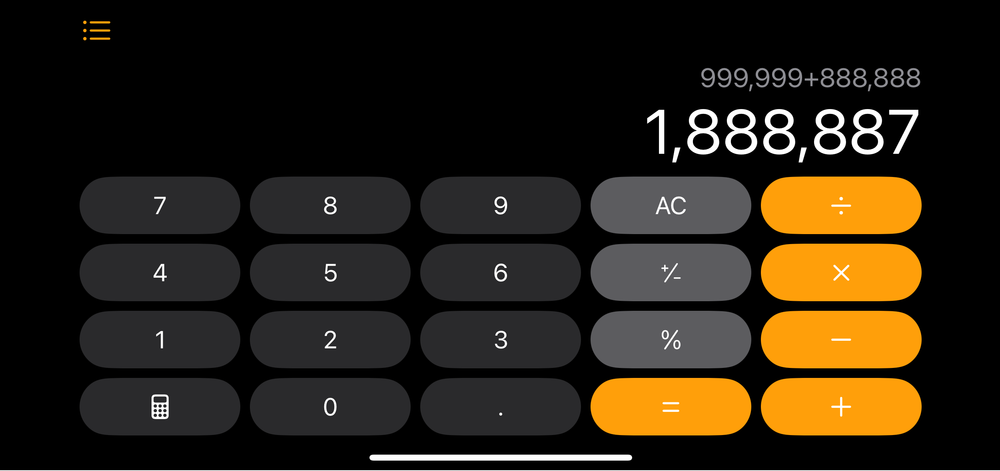

import TruthTable from "@mdx/components/TruthTable";
import Flow from "@yeolyi/logic";
import halfNand from "./assets/half-nand.json";
import half from "./assets/half.json";

지금까지 논리 게이트를 조합해 신호를 선택하고 분배하는 회로를 만들어보았습니다.
이번 글에서는 게이트를 조합해서 실제로 **덧셈**을 수행하는 회로를 직접
만들어봅시다.



스마트폰의 계산기 앱은 사람보다 훨씬 빠르게 덧셈을 합니다. 999,999 + 888,888
같은 계산도 순식간에 해냅니다. 그런데 그 계산기의 핵심도 결국 우리가 지금까지
배운 **논리 게이트들의 조합일 뿐**입니다.

## 십진수 덧셈

컴퓨터가 어떻게 덧셈을 하는지 알아보기 전에, 우리가 평소에 어떻게 덧셈을 하는지
돌아봅시다. 예를 들어 `123 + 456`을 어떻게 계산할까요?

```txt
  123
+ 456
-----
  579
```

우리는 자연스럽게 오른쪽부터 한 자리씩 계산합니다. 만약 한 자리에서 10이 넘는
결과가 나오면 올림을 해서 다음 자리에 더해줍니다.

올림이 있는 좀 더 복잡한 예를 봅시다. `179 + 287`을 계산해보면:

```txt
  11  <-- (올림)
  179
+ 287
-----
  466
```

1. `9 + 7 = 16`이므로 6을 쓰고 1을 올림합니다.
2. `1 + 7 + 8 = 16`이므로 6을 쓰고 1을 올림합니다.
3. `1 + 1 + 2 = 4`입니다.

이 과정을 잘 보면 두 가지 핵심 요소가 있습니다:

- 각 자리에서 두 숫자를 더한 결과 (**Sum**)
- 다음 자리로 넘어가는 올림 (**Carry**)

바로 이 두 가지가 컴퓨터가 덧셈을 하는 핵심 아이디어입니다. 그런데 컴퓨터는 0과
1만 알고 있지 않습니까. 어떻게 이 원리를 0과 1의 세계로 옮길 수 있을까요?

## 이진수 덧셈

컴퓨터는 수를 0과 1 두 숫자만 쓰는 [이진법](/zero-and-one)으로 나타냅니다.
자리가 하나 올라갈 때마다 10배가 아니라 2배씩 커지는 표기법입니다. 예를 들어
이진수 101<sub>2</sub>은 4 + 0 + 1 = 5<sub>10</sub>입니다.

덧셈하는 방법도 십진수와 같습니다. 간단한 예부터 시작해봅시다.

십진수 3<sub>10</sub> + 1<sub>10</sub> = 4<sub>10</sub>를 이진수 버전으로
계산해보면 11<sub>2</sub> + 01<sub>2</sub> = 100<sub>2</sub>가 됩니다.

```txt
  11   <-- (올림)
   11
+  01
-----
  100
```

1. 1 + 1을 하면 십진수에서는 2<sub>10</sub>지만 이진수로 표현하면
   10<sub>2</sub>입니다. 즉, 현재 자리는 0이 되고 다음 자리로 1을 올림합니다.
1. 1(올림) + 1 + 0 = 10<sub>2</sub>이므로 현재 자리는 0, 다음 자리로 1을
   올림합니다.

결과적으로 100₂가 나오고, 이는 십진수 4와 같습니다.

이 과정에서 핵심은 십진수 때와 마찬가지로 각 자리에서 발생하는 두 가지
결과입니다:

- 현재 자리의 결과 (**Sum**)
- 다음 자리로 넘어가는 올림 (**Carry**)

## 반가산기

이제 본격적으로 덧셈 회로를 만들어봅시다. 한 자리 이진수 두 개를 더하는 가장
간단한 경우를 생각해봅시다.

가능한 모든 경우를 나열해보면:

```txt
0 + 0 = 0
0 + 1 = 1
1 + 0 = 1
1 + 1 = 10
```

마지막 경우가 흥미롭습니다. 1 + 1은 10<sub>2</sub>이 됩니다. 즉, 현재 자리
결과(Sum)는 0이고 다음 자리로 넘어가는 올림(Carry)은 1이 발생하는 것입니다.

진리표를 보면 Sum은 A와 B가 다를 때만 1이 되고, Carry는 A와 B가 모두 1일 때만
1이 됩니다.

<TruthTable
  labels={[
    { label: "A", type: "input" },
    { label: "B", type: "input" },
    { label: "Sum", type: "output" },
    { label: "Carry", type: "output" },
  ]}
  data={[
    [false, false, false, false],
    [false, true, true, false],
    [true, false, true, false],
    [true, true, false, true],
  ]}
  client:idle
/>

위의 진리표를 논리 게이트로 구현하면 한자리수 이진수 덧셈을 할 수 있는 계산기를
만든 것입니다. [이전 글](/nand-is-all-you-need)에서 배운 대로 NAND
게이트만으로 구현하면 아래와 같습니다.

<Flow id="half-nand" initialJSON={halfNand} client:idle />

이 회로를 **반가산기(Half Adder)**라고 합니다. 이후 논의에서는 간결함을 위해
이를 하나의 블록으로 묶어 HALF ADDER로 표기합니다.

<Flow id="half" initialJSON={half} client:idle />

## 마무리

반가산기는 한 자리 이진수 두 개의 덧셈만 처리할 수 있습니다. 하지만 실제
덧셈에서는 아래 자리에서 올라온 올림값도 함께 처리해야 합니다.
[다음 글](/full-adder)에서는 이 문제를 해결하는 전가산기를 만들어봅시다.
